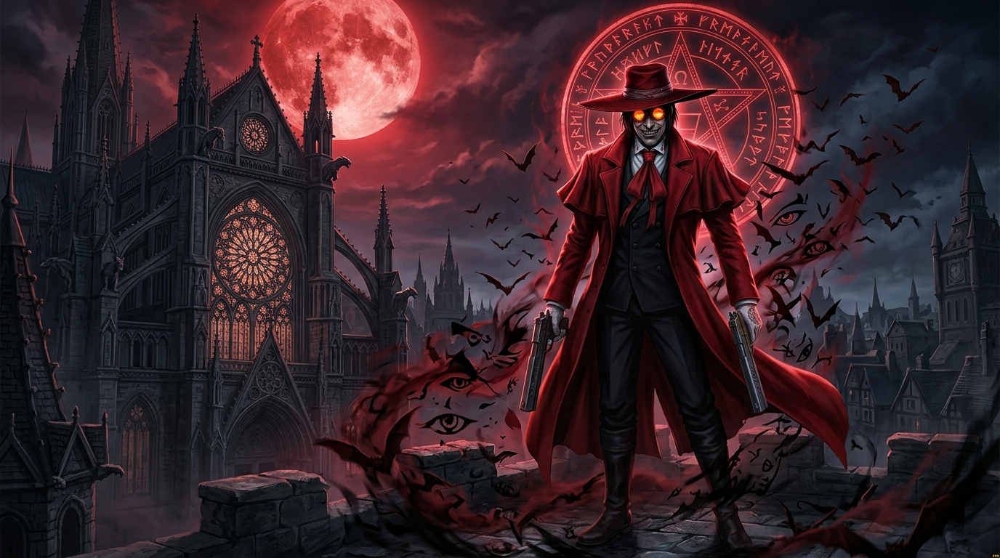
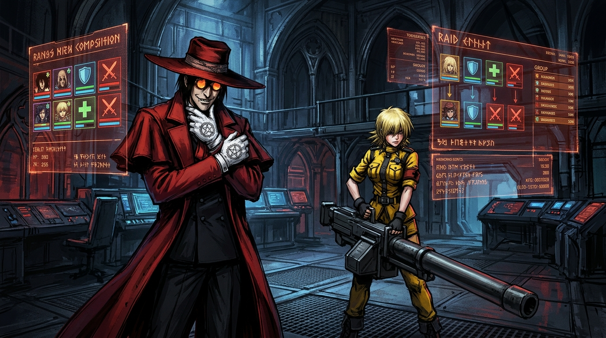
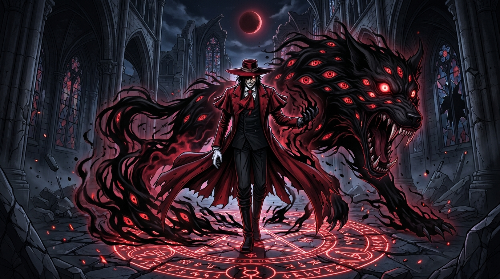
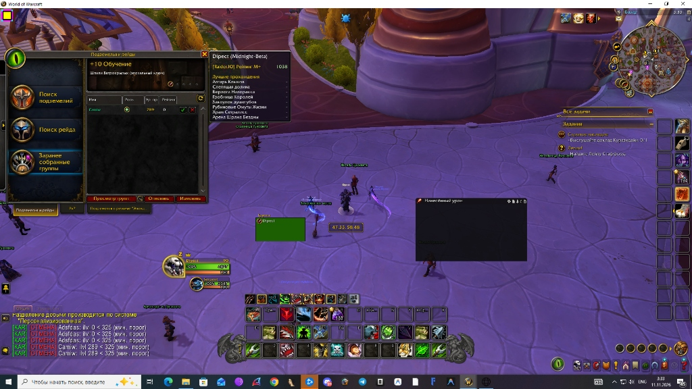
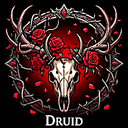
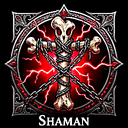
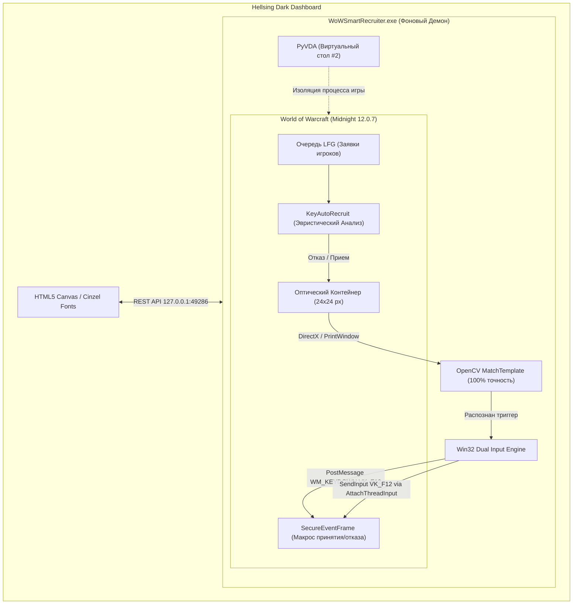

# 🩸 HELLSING ORGANIZATION — World of Warcraft Autonomous Recruiter

<p align="center">
  <a href="https://drive.google.com/open?id=1ikS7HS-iWfV-dWAJLUCNg8LPDV8_zdEt&usp=drive_fs" target="_blank">
    
  </a>
  <a href="https://github.com/alucard5552/Hellsing-WoW-Recruiter" target="_blank">
    
  </a>
  <a href="https://alucard5552.github.io/Hellsing-WoW-Recruiter/" target="_blank">
    
  </a>
</p>

<p align="center">
  👉 <b><a href="https://drive.google.com/open?id=1ikS7HS-iWfV-dWAJLUCNg8LPDV8_zdEt&usp=drive_fs">📥 [ СКАЧАТЬ ИНСТАЛЛЯТОР В 1 КЛИК С GOOGLE ДИСКА (112 МБ) ]</a></b> &nbsp;|&nbsp;
  <b><a href="https://github.com/alucard5552/Hellsing-WoW-Recruiter">📂 [ GitHub Репозиторий ]</a></b> &nbsp;|&nbsp;
  <b><a href="https://alucard5552.github.io/Hellsing-WoW-Recruiter/">🌐 [ Сайт-Визитка ]</a></b>
</p>

<p align="center">
  
</p>

<p align="center">
  <a href="https://github.com/alucard5552/Hellsing-WoW-Recruiter/releases"></a>
  
  
  
  
  <a href="LICENSE"></a>
</p>

---

> [!WARNING]
> ### ⚠️ ВНИМАНИЕ: СЕРВЕРНАЯ СОВМЕСТИМОСТЬ И РИСК БЛОКИРОВКИ
> **Протестировано ИСКЛЮЧИТЕЛЬНО на пиратском сервере Firestorm (WoW Midnight 12.0.7 / The War Within)!**  
> **На официальных серверах (Blizzard Retail / Офф) ВОЗМОЖНЫ БЛОКИРОВКИ АККАУНТА (БАНЫ)!**  
> Проект разрабатывался под архитектуру Firestorm. Любое использование на официальных серверах Blizzard строго не рекомендуется и осуществляется исключительно на ваш собственный страх и риск.

---

> *"The bird of Hermes is my name, eating my feathers to make me tame."*  
> — **Alucard**, Royal Order of Protestant Knights (HELLSING Organization)

**HELLSING WoW Autonomous Recruiter** — элитный программный комплекс следующего поколения для автоматизированного набора, фильтрации и принятия/отклонения заявок в подземелья Mythic+ и рейды World of Warcraft (*The War Within* и *Midnight 12.0.7*). 

Построен на принципах нулевой модификации памяти клиента (**Zero-Taint Optical Bridge**), аппаратной эмуляции нажатий клавиатуры (только физический `F12`), полной изоляции на виртуальном рабочем столе Windows и децентрализованной P2P-синхронизации между участниками группы.

---

## 📸 Галерея и Визуальный Стиль HELLSING

<p align="center">
  
  <br><em>Командный центр HELLSING: голографический мониторинг очередей LFG, эвристический скоринг кандидатов и телеметрия OpenCV</em>
</p>

<p align="center">
  
  <br><em>Restriction Control Art Level 0: мгновенная фильтрация и отсечение слабых кандидатов демонической гончей Баскервилей</em>
</p>

### 👁️ Реальное распознавание в World of Warcraft 12.0.7 Midnight
В клиенте игры аддон `KeyAutoRecruit` проецирует в угол экрана 24×24 оптический контейнер с калибровочной рамкой Cyan `RGB(0, 217, 255)` и сигнальным ядром (Желтый — отказ, Зеленый — хил, Оранжевый — ДД, Голубой — танк):

<p align="center">
  
  <br><em>Автоматический отказ кандидату с ilvl 289 &lt; 325 в клиенте Firestorm Midnight 12.0.7</em>
</p>

### 🛡️ Готические гербы классов (HELLSING Class Crests)
Интерфейс аддона и дашборда оформлен авторскими эмблемами 13 классов World of Warcraft в кроваво-готической стилистике:

<p align="center">
  
  
  
  
  
  
  
  
  
  
  
  
  
</p>

---

## ⚡ Ключевые Архитектурные Преимущества



### 1. 🩸 Zero-Taint Optical Bridge (OpenCV Template Matching)
- **Полное отсутствие хуков памяти и DLL-инжекций**: Защищено от любых античитов и сигнатурных сканеров.
- Аддон кодирует решение о кандидате через сигнальный квадрат в координатах `(25, 22)`.
- Компьютерное зрение OpenCV с точностью **100% (confidence = 0.0)** и скоростью **&lt; 15 мс** мгновенно считывает цвет даже в свернутом окне.

### 2. ⌨️ Pure Hardware F12 Input (Клик мыши отключен на 100%)
- **Никаких кликов мыши**: Курсор пользователя свободен, исключены случайные клики по рабочему столу.
- Двойной параллельный ввод клавиши `F12`:
  - Прямой `PostMessage(hwnd, WM_KEYDOWN, VK_F12, lparam)` прямо в окно WoW.
  - Аппаратный физический `SendInput(VK_F12, SC_F12)` через Win32 `AttachThreadInput` для гарантированного снятия foreground-блокировок.

### 3. 🖥️ Zero-Interference Virtual Desktop Isolation
- Игра переносится на выделенный виртуальный рабочий стол Windows (Стол #2).
- Вы можете работать, смотреть фильмы, играть в другие игры на Столе #1 — рекрутер непрерывно сканирует и принимает кандидатов в фоне.
- Автоматический возврат фокуса окна за 15 мс при необходимости отправки клавиши.

### 4. 🕸️ P2P Mesh Network (KAR_P2P_Tester)
- Децентрализованная синхронизация базы черного списка и истории кандидатов между всеми членами пати через аддон-канал (`C_ChatInfo.SendAddonMessage`).
- Никаких внешних баз данных или сторонних веб-серверов.

---

## 🛠️ Инструкция по ручной сборке (Manual Build Guide)

Если вы хотите скомпилировать проект самостоятельно из чистых исходников:

### 1. Предварительные требования (Prerequisites)
- **ОС**: Windows 10 / 11 (x64)
- **Python**: 3.10, 3.11, 3.12, 3.13 или 3.14 (x64)
- **Git**

### 2. Клонирование репозитория
```cmd
git clone https://github.com/alucard5552/Hellsing-WoW-Recruiter.git
cd Hellsing-WoW-Recruiter
```

### 3. Установка зависимостей
Выполните скрипт или установите пакеты вручную:
```cmd
scripts\install_dependencies.bat
```
*Или через pip:*
```cmd
python -m pip install --upgrade pip
python -m pip install -r requirements.txt
```

### 4. Проверка синтаксиса перед сборкой
Убедитесь, что все скрипты валидны (0 ошибок):
```cmd
python check_lua_syntax.py "AddOns\KeyAutoRecruit\KeyAutoRecruit.lua"
python -m py_compile wow_voice_clicker.py html_installer.py
```
> Ожидаемый вывод Lua: `PERFECT: 0 unclosed blocks (0 errors)`.

### 5. Сборка исполняемых файлов

#### Вариант A: Автоматическая сборка в 1 клик
Запустите:
```cmd
scripts\build_all.bat
```
*Или через PowerShell:*
```powershell
powershell -ExecutionPolicy Bypass -File scripts\build_all.ps1
```

#### Вариант B: Ручная сборка по шагам

**Шаг 5.1: Компиляция фонового демона (`WoWSmartRecruiter.exe`)**
```cmd
python -m PyInstaller --clean -y WoWSmartRecruiter.spec
copy /y dist\WoWSmartRecruiter.exe .
```
- Результат: `dist\WoWSmartRecruiter.exe` (~67 МБ).
- Бинарник монолитен, полностью очищен от Tkinter/Tcl для предотвращения ошибок распаковки `cp950.enc`.

**Шаг 5.2: Компиляция автономного инсталлятора (`HELLSING_Recruiter_Setup.exe`)**
```cmd
python -m PyInstaller --clean -y HELLSING_Recruiter_Setup.spec
```
- Результат: `dist\HELLSING_Recruiter_Setup.exe` (~117 МБ).
- Включает в себя HTML5 Chromium GUI, аддоны для Midnight 12.0.7, текстуры, иконки и скомпилированный демон рекрутера.

---

## 🎮 Горячие клавиши (Hotkeys)

| Клавиша | Функция | Описание |
|---|---|---|
| `NumPad 1` | **Авто-набор (Старт / Пауза)** | Включает и выключает оптическое сканирование и отправку `F12`. |
| `NumPad 5` | **Дашборд HELLSING** | Открывает стилизованный веб-интерфейс (127.0.0.1:49286). |
| `NumPad 8` | **Виртуальный стол** | Мгновенно переносит окно WoW на отдельный скрытый рабочий стол. |
| `NumPad 9` | **Возврат окна WoW** | Возвращает окно World of Warcraft на текущий экран пользователя. |
| `F11` | **Калибровка сенсора** | В игре: запускает тестовую вспышку белого квадрата для автокалибровки OpenCV. |
| `F12` | **Аппаратный триггер** | Зарезервированная клавиша ввода макроса кликера. |

---

## 📜 Внутриигровая настройка (In-Game Setup)

1. Установите аддоны из папки `AddOns/` в каталог вашей игры:
   `World of Warcraft\_midnight_\Interface\AddOns\` (или `_retail_`).
2. В игре создайте макрос и назначьте его на клавишу `F12`:
   ```lua
   /click secureEventFrame
   ```
3. Откройте панель набора подземелья или рейда (`I` -> Заранее собранные группы).
4. Запустите рекрутер: нажмите `NumPad 1`. Система автоматически начнет фильтровать и подтверждать кандидатов в строгом соответствии с вашими критериями рейтинга, роли и экипировки!

---

## ⚖️ Лицензия (License)

Проект распространяется под открытой лицензией [MIT License](LICENSE).  
Copyright (c) 2026 HELLSING Organization / Alucard Blackwell (`alucard5552`).
